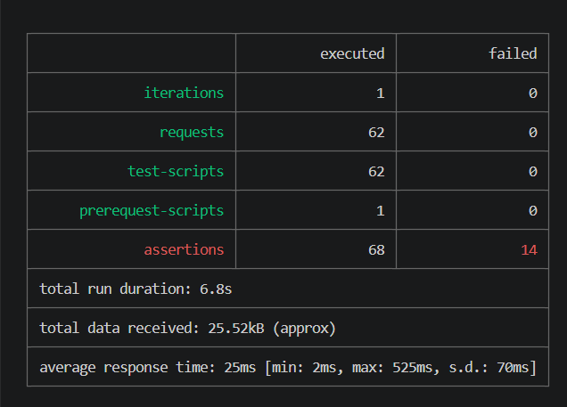

# 360° Corporate Development Platform – API Testing

API test suite I built as the QA Engineer on a UCSC industry project: a 360° corporate development platform (MERN stack). Shared with the client's permission. All data is test data.

## Test coverage
**62 requests, 68 assertions**, organised into testing rounds:

| Folder | Requests | Focus |
|---|---|---|
| 0 Setup | 5 | Log in as HR and employee, save tokens and IDs |
| Round 1 – Employee token security | 7 | Role-based access (403), missing and fake tokens (401), bad IDs |
| Round 3 – Assignment and hierarchy | 17 | Department, employment type and manager assignment; inactive records; reporting loops |
| Round 4 – Activation | 10 | OTP-based account activation, invalid OTPs, password rules, token reuse |
| Round 5 – Performance framework | 21 | Draft and active frameworks, competency and KPI weights, weights totalling 100%, archived frameworks |
| Round 6 – Scoring and templates | 2 | Exploratory checks on upcoming endpoints |

## Techniques used
- Positive, negative, boundary and security test cases
- Role-based access testing with HR tokens, employee tokens, fake tokens and no tokens
- Setup and cleanup requests so tests are repeatable
- Chained requests: tokens and record IDs are saved as environment variables
- Test case IDs (e.g. TC-API-03, TC-PF-19) linked to the written test cases

## Latest run results
**54 of 68 assertions passed.** The 14 failures are expected and tracked:

| Category | Count | Details |
|---|---|---|
| Not yet developed | 4 | Scoring and review-template endpoints return 404 |
| Blocked | 6 | Manager assignment returns 500 (transaction error) |
| Manual step | 2 | OTP must be entered manually from the server log |
| Defects found | 2 | Activation token can be reused (200); a 300-character name is accepted (201) |

## Tools used
- Postman (collections, environments, JavaScript test scripts)
- Newman CLI with HTML reports

## How to run
The API runs on a private development server, so these tests can't run publicly. With the backend running on `localhost:5000`:
1. Run `npm install -g newman newman-reporter-htmlextra`
2. Run `newman run 360-qa-checks.postman_collection.json -e 360-local.postman_environment.json -r "cli,htmlextra"`

## Test report
